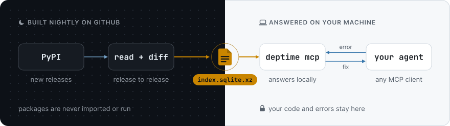

<h1 align="center">
  <picture>
    <source media="(prefers-color-scheme: dark)" srcset="https://raw.githubusercontent.com/cschmertz/deptime/main/docs/assets/deptime-wordmark-dark.svg">
    
  </picture>
</h1>

<p align="center"><b>Know what a Python dependency update breaks before you merge it.</b></p>

<div align="center">

[](https://pypi.org/project/deptime/)
[](https://pypi.org/project/deptime/)
[](https://github.com/marketplace/actions/deptime-upgrade-check)
[](https://github.com/cschmertz/deptime/actions/workflows/ci.yml)
[](https://github.com/cschmertz/deptime/actions/workflows/build-index.yml)
[](https://github.com/cschmertz/deptime/blob/main/LICENSE)
[](https://glama.ai/mcp/servers/cschmertz/deptime)

</div>

Python libraries rename and remove things from one release to the next, so a routine dependency update, from Dependabot, Renovate or you, can break code that used to work.

DepTime points to **each line of your code an update breaks**, says **in which release it changed**, and names **what to use instead**. No AI model in the loop: it runs on your machine, costs nothing, and gives the same answer every time. Your coding agent can use it too.

<p align="center">
<picture>
  <source media="(prefers-color-scheme: dark)" srcset="https://raw.githubusercontent.com/cschmertz/deptime/main/docs/assets/upgrade-dark.svg">
  
</picture>
</p>

- **Facts, not guesses.** Answers come from comparing each library's own code release by release, and they show the evidence.
- **Private and free.** Open source (MIT) and runs on your machine. Your code and errors stay there.
- **Honest about gaps.** When it doesn't cover a package or can't tell, it says so instead of guessing.

**Status:** stable (1.0). The data updates itself twice a day. Spotted a wrong answer? [Report it](https://github.com/cschmertz/deptime/issues/new/choose) and it becomes a test case.

## Get started

You need [uv](https://docs.astral.sh/uv/).

**Check an update.** After updating your lockfile or requirements, run this in your project:

```bash
uvx deptime check-upgrade
```

It compares your pinned versions with the last commit and exits with 1 when the update breaks something. To check every update pull request, add the [GitHub Action](#check-a-dependency-update-before-you-merge-it).

**Give your coding agent the same answers.** Add DepTime to Claude Code:

```bash
claude mcp add deptime -- uvx deptime mcp
```

Other AI coding tools (Cursor, Codex, VS Code, Claude Desktop and more) use the same command, `uvx deptime mcp`, in their MCP settings.
To make sure the agent uses it, paste [this short block](integrations/snippets/agents-md-deptime.md) into your project's `AGENTS.md` (Codex and Cursor read it).

That's it. The first time it starts, DepTime downloads its data file (about 55 MB) and keeps it up to date on its own. To keep it fully offline, set `DEPTIME_OFFLINE=1`.

**Using Claude Code?** The plugin adds a `/deptime:fix-upgrade` command and suggests DepTime when a version error shows up:

```text
/plugin marketplace add cschmertz/deptime
/plugin install deptime@deptime
```

<details>
<summary>First start timing out on a Mac?</summary>

If your `uv` is the Intel version (an Intel Mac, or Intel Homebrew on an Apple-silicon Mac), the first install has to compile one dependency, which can take a few minutes, longer than most apps wait. Run `uvx deptime --help` once in a terminal first; after that it starts in seconds.
</details>

## What you can do with it

### Check a dependency update before you merge it

On a pull request (from Dependabot, Renovate or a person), the GitHub Action marks each line the update breaks and fails the check only when something really breaks ([setup guide](https://github.com/cschmertz/deptime/blob/main/docs/github-action.md)):

```yaml
# .github/workflows/upgrade-check.yml
on:
  pull_request:
    paths: ["**/uv.lock", "**/poetry.lock", "pyproject.toml", "**/requirements*.txt", "**/requirements/**"]
permissions:
  contents: read
jobs:
  check:
    runs-on: ubuntu-latest
    steps:
      - uses: actions/checkout@v7 # pin to a commit in your own workflows
      - uses: cschmertz/deptime@v1.2.1
```

You can run the same check from a terminal with `uvx deptime check-upgrade`, or in Claude Code with `/deptime:fix-upgrade`, which also has Claude fix what broke.

Tried on 264 real update pull requests, it caught all 13 that broke their project and raised a false alarm on 2 ([results](https://github.com/cschmertz/deptime/blob/main/bench/upgrade-check/prs/results-2026-11-16.md)). With `/deptime:fix-upgrade`, Claude fixed 86.7% of 60 broken updates it hadn't seen before, against 76.7% on its own, in about half the steps ([results](https://github.com/cschmertz/deptime/blob/main/bench/agent-fix/qa27/results-2026-11-17.md)).

### Understand an error

When an import or call into a library fails, your agent (or you, from a terminal) passes the error to DepTime and gets back what changed, in which release, and what to use instead:

<picture>
  <source media="(prefers-color-scheme: dark)" srcset="https://raw.githubusercontent.com/cschmertz/deptime/main/docs/assets/demo-dark.svg">
  
</picture>

In plain words:

> httpx.Client.__init__ accepted `proxies` up to httpx 0.27.2; it is gone from 0.28.0 onward. Deprecated in 0.26.0 ("The 'proxies' argument is now deprecated. Use 'proxy' or 'mounts' instead."). Use `proxy` or `mounts` instead, or pin httpx<=0.27.2.

<details>
<summary>The full answer your agent receives</summary>

```json
{
  "symbol": "httpx.Client.__init__(proxies)",
  "issue": "param_removed",
  "installed_version": "0.28.1",
  "last_version_with": "0.27.2",
  "first_version_without": "0.28.0",
  "deprecated_in": "0.26.0",
  "replacements": [
    {"target": "proxy", "confidence": 0.8, "source": "deprecation_message"},
    {"target": "mounts", "confidence": 0.79, "source": "deprecation_message"}
  ],
  "pin_to_restore": "httpx<=0.27.2",
  "confidence": "high"
}
```

That's the real answer from the published data, trimmed. The full answer also quotes the warning DepTime found in httpx's own code.
</details>

### Check code before it runs

Your agent can ask whether a function or argument it remembers still exists in the version you have installed, or what changed between two versions (or since a date, such as its training cutoff).

**Migrating by hand?** The [rename maps](https://cschmertz.github.io/deptime/) show what well-known migrations (NumPy 2, pandas 2 and 3, Polars 1 and 2, pydantic 2, LangChain 1, the MCP SDK 2, Gradio 6 and more) renamed or removed, and what replaces each name, from the same data.

## The tools

| Tool | What it's for |
|---|---|
| `explain_error` | An import or call into a library just failed |
| `check_upgrade` | You're updating a dependency: which lines of your code break? |
| `check_symbols` | Check names and arguments against the version you have installed |
| `diff_versions` | Everything that changed between two versions, or since a date |
| `symbol_history` | The full history of one function or class |
| `coverage` | Which libraries DepTime knows: 60 fast-moving packages, from the AI and agent stack to web frameworks and data tools ([list](https://github.com/cschmertz/deptime/blob/main/docs/coverage.md)) |

Every answer says how sure it is and why. The exact inputs and outputs are in the [product spec](https://github.com/cschmertz/deptime/blob/main/docs/03-product-spec.md).

## How well it works

Every number below is a **first try**: the test cases and their right answers were collected before DepTime ever saw them.

| How often does it… | First try | Tested on |
|---|---|---|
| name the right library, function and release from a real error? | **87%** (166 of 191) | Errors from GitHub issues and Stack Overflow |
| *…and an AI model alone, from memory?* | *82% to 84%* (Claude Sonnet 5.5 and Opus 5.5), *66% to 69%* (Claude Haiku 5.5), *59%* (DeepSeek V4.1 Flash), *19%* (Qwen3.5 9B) | [The same 191 errors](https://github.com/cschmertz/deptime/blob/main/bench/model-alone/results-2026-11-15.md) |
| suggest the right replacement in its top three? | **48%** (41 of 85) | The same errors, where a replacement exists |
| wrongly flag code that still works after an update? (lower is better) | **0.1%** (2 of 2,047) | Real projects, checked by actually running them |
| find the code an update breaks? | **100%** (147 of 147) | The same projects |
| *…and an AI model alone, from memory?* | Breaks found / working code flagged: *91% / 0.2%* (Claude Sonnet 5.5), *74% / 0.3%* (Claude Haiku 5.5), *81% / 2.7%* (DeepSeek V4.1 Flash), *31% / 15%* (Qwen3.5 9B) | [The same projects](https://github.com/cschmertz/deptime/blob/main/bench/model-alone/upgrades/results-2026-11-15.md), scored so that "can't tell" counts as not flagged: DepTime then finds 96.7% |

- **Checking updates is its strongest skill.** It finds nearly every break and almost never cries wolf. The rows on projects are from the newest of six test sets; across all six, it found 95.9% to 100% of breaks and wrongly flagged 0.05% to 3.8% of working code.
- **It helps smaller models most.** The best Claude models come close on their own; smaller and cheaper ones fall well behind.
- **Suggesting replacements is its weakest skill.** It gets the right one about half the time, so it tells your agent how confident it is.

Every test set and result is in the [benchmark](https://github.com/cschmertz/deptime/blob/main/bench/README.md#results-every-check-first-run-and-now), re-checked automatically on every change. The test sets are also published on their own, with a scorer, so any other tool or model can be measured the same way: the [API-change benchmark](https://github.com/cschmertz/deptime/blob/main/bench/dataset/README.md).

## What it doesn't do

- **It covers the libraries on its [list](https://github.com/cschmertz/deptime/blob/main/docs/coverage.md), not all of PyPI.** For anything else it says "not covered".
- **It reads code without running it.** A few names that only appear while a library runs can come back as `unknown`.
- **It sees names and arguments, not behaviour.** If a function keeps its name but does something different, DepTime can't tell, so keep running your tests.
- **Python only.**

## How it works

<p>
<picture>
  <source media="(prefers-color-scheme: dark)" srcset="https://raw.githubusercontent.com/cschmertz/deptime/main/docs/assets/how-it-works-dark.svg">
  
</picture>
</p>

Twice a day, GitHub reads each new release of every covered library (without running it), compares it with the release before, and publishes the result as one file, signed so anyone can check it came from that build ([how](https://github.com/cschmertz/deptime/blob/main/SECURITY.md#verifying-the-index)). DepTime downloads that file and answers every question on your machine, in milliseconds. More in the [architecture doc](https://github.com/cschmertz/deptime/blob/main/docs/04-architecture.md).

## Works with

Claude Code, Claude Desktop, Cursor, VS Code, Codex and any app that speaks MCP, on Linux, macOS and Windows, with Python 3.12 to 3.15. From a fresh install to the first answer takes about 10 seconds on Linux and Mac and 20 on Windows ([client tests](https://github.com/cschmertz/deptime/tree/main/bench/s5), [first-start tests](https://github.com/cschmertz/deptime/tree/main/bench/s7)).

<details>
<summary>Command line</summary>

```bash
uvx deptime explain --installed httpx==0.28.1 < traceback.txt
uvx deptime history httpx Client.__init__
uvx deptime check httpx 0.28.1 'httpx.Client:proxies,proxy'
uvx deptime diff httpx 0.27.2 0.28.1
uvx deptime diff pydantic 2024-06-01              # everything since a date
uvx deptime check-upgrade                         # what the lockfile change breaks; exit 1 on a break
uvx deptime index status | pull
```
</details>

<details>
<summary>Hosting it yourself</summary>

For web apps that only accept a URL, run `deptime serve` on any container host (a `Dockerfile` and `fly.toml` are included). See [self-hosting](https://github.com/cschmertz/deptime/blob/main/docs/05-self-hosting.md).
</details>

## Credits

**Built on** [griffe](https://github.com/mkdocstrings/griffe), which reads the libraries' code.

**How it differs from docs tools** like [Context7](https://context7.com) and [Ref](https://ref.tools): they show the docs for a version; DepTime tells you when something changed and what replaced it.

## Contributing

The most helpful thing you can send is a wrong answer: each one becomes a test case. See [CONTRIBUTING.md](https://github.com/cschmertz/deptime/blob/main/CONTRIBUTING.md). To work on the code:

```bash
uv sync && uv run pytest
```

**More:** [Product spec](https://github.com/cschmertz/deptime/blob/main/docs/03-product-spec.md) · [Architecture](https://github.com/cschmertz/deptime/blob/main/docs/04-architecture.md) · [Privacy & security](https://github.com/cschmertz/deptime/blob/main/docs/08-privacy-and-security.md) · [Benchmark](https://github.com/cschmertz/deptime/blob/main/bench/README.md) · [Changelog](https://github.com/cschmertz/deptime/blob/main/CHANGELOG.md) · [License (MIT)](https://github.com/cschmertz/deptime/blob/main/LICENSE)

<!-- mcp-name: io.github.cschmertz/deptime -->
