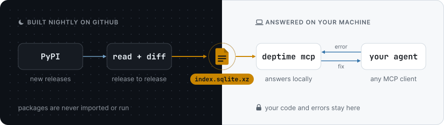

<h1 align="center">
  <picture>
    <source media="(prefers-color-scheme: dark)" srcset="https://raw.githubusercontent.com/cschmertz/deptime/main/docs/assets/deptime-wordmark-dark.svg">
    
  </picture>
</h1>

<p align="center"><b>An API time machine for Python libraries, built for coding agents.</b></p>

<div align="center">

[](https://pypi.org/project/deptime/)
[](https://pypi.org/project/deptime/)
[](https://github.com/cschmertz/deptime/actions/workflows/ci.yml)
[](https://github.com/cschmertz/deptime/actions/workflows/build-index.yml)
[](https://github.com/cschmertz/deptime/blob/main/LICENSE)
[](https://glama.ai/mcp/servers/cschmertz/deptime)

</div>

When an agent hits `ImportError`, `AttributeError` or "unexpected keyword argument" in a fast-moving library, one call to DepTime says **what changed, in which release, and what to use instead**. Answers are computed from static diffs of every indexed release, not from docs or model memory.

Free, open source (MIT), and **local**: your code and errors never leave your machine.

<p>
<picture>
  <source media="(prefers-color-scheme: dark)" srcset="https://raw.githubusercontent.com/cschmertz/deptime/main/docs/assets/how-it-works-dark.svg">
  
</picture>
</p>

Every night, GitHub Actions reads each new release's public API with [griffe](https://mkdocstrings.github.io/griffe/), which parses the source without running it, diffs it against the previous release, and publishes the result as one file, `index.sqlite.xz`, on this repo's Releases. On your machine, `deptime mcp` checks that file's sha256 and schema before swapping it in, then answers every question locally in milliseconds. The full design is in [docs/04-architecture.md](https://github.com/cschmertz/deptime/blob/main/docs/04-architecture.md), and the decisions are in [docs/adr/](https://github.com/cschmertz/deptime/tree/main/docs/adr).

```text
TypeError: Client.__init__() got an unexpected keyword argument 'proxies'
```

```json
{
  "symbol": "httpx.Client.__init__(proxies)",
  "issue": "param_removed",
  "installed_version": "0.28.1",
  "last_version_with": "0.27.2",
  "first_version_without": "0.28.0",
  "deprecated_in": "0.26.0",
  "replacements": [
    {"target": "proxy", "confidence": 0.8, "source": "deprecation_message"},
    {"target": "mounts", "confidence": 0.79, "source": "deprecation_message"}
  ],
  "pin_to_restore": "httpx<=0.27.2",
  "confidence": "high"
}
```

That's the real `explain_error` answer from the published index, trimmed. The full answer also quotes the deprecation message DepTime found in httpx's own source, and adds a one-sentence explanation for your agent to pass on.

> **Status:** alpha. The prebuilt index is rebuilt twice a day. Known gaps are tracked in [BACKLOG.md](https://github.com/cschmertz/deptime/blob/main/BACKLOG.md).

## How well it works

Each check's right answers were written down before DepTime first ran on it ([bench/](https://github.com/cschmertz/deptime/tree/main/bench)). Judge DepTime by the first run: the fixes since then were designed from its misses, so the later numbers are flattering.

| Check | Cases | First run | Now |
|---|---|---|---|
| Right package, name and breaking release for a traceback from a GitHub issue, on the [holdout of 2026-11-10](https://github.com/cschmertz/deptime/blob/main/bench/holdout/2026-11d/results-2026-11-10.md) | 30, after every fix so far | 86.7% | 86.7% |
| Code that still works after an upgrade, flagged as broken by `check_symbols` (lower is better) | 2,279 uses from 174 upgrades of real projects, labelled by running them | 0.9% | 0.9% |
| The same, by `diff_versions(used_symbols=...)` | 2,279 | 0.7% | 0.7% |
| Code that breaks, flagged by `check_symbols` / `diff_versions` | 176 uses | 96.6% / 96.0% | 96.6% / 96.0% |
| The same four, on the [holdout of 2026-11-09](https://github.com/cschmertz/deptime/blob/main/bench/holdout/2026-11c/results-2026-11-09.md): tracebacks; working code flagged by `check_symbols` / `diff_versions`; breaks flagged | 35; 1,801 / 1,841 uses; 128 | 88.6%; 0.5% / 0.3%; 99.2% / 99.2% | 97.1%; 0.06% / 0%; 100% / 98.4% |
| The same four, on the [holdout of 2026-11-08](https://github.com/cschmertz/deptime/blob/main/bench/holdout/2026-11b/results-2026-11-08.md): tracebacks; working code flagged by `check_symbols` / `diff_versions`; breaks flagged | 37; 2,503 / 2,542 uses; 146 (140 once six wrong labels are corrected) | 91.9%; 1.5% / 0.2%; 95.9% / 95.9% | 100%; 0% / 0%; 100% / 100% |
| The same four, on the [holdout of 2026-11-07](https://github.com/cschmertz/deptime/blob/main/bench/holdout/2026-11/results-2026-11-07.md): tracebacks; working code flagged by `check_symbols` / `diff_versions`; breaks flagged | 35; 3,600 / 2,399 uses; 130 | 88.6%; 3.8% / 0.3%; 97.7% / 76.9% | 100%; 0.1% / 0.1%; 98.4% / 98.5% |
| Right package, name and breaking release for a traceback from a GitHub issue | 32 collected 2026-11-05 | 68.8% | 100% |
| The same, on a holdout fixed in advance from [TimeMachine-bench](https://github.com/tohoku-nlp/timemachine-bench) | 29 | 72.4% | 96.6% |
| Error kind and package read from the traceback: scripts, pytest, chained exceptions, `ExceptionGroup`, IPython, Python 3.10–3.14 | 736, holdout fixed in advance | 93.8% | 100% |
| Replacement hints at confidence ≥ 0.75 that are right | hints for 50 documented migrations | 11 of 11 | 42 of 45 |
| Documented migrations that get a right hint at ≥ 0.75 | 50 | 11 | 42 (32 without hand-checked hints from migration guides) |
| Names that exist at runtime but read as absent | 2,428 sampled at runtime from 10 dynamic packages | 5.1% | 1.2% |

`check_symbols` answers `unknown`, with the reason, where the index can't tell (a path through an instance such as `pytest.mark`, or into a distribution it doesn't cover): 55 working uses and 2 breaks of the 2026-11-10 holdout (40 working uses and 4 breaks of 2026-11-09's, 43 working uses of 2026-11-08's, 79 working uses and 4 breaks of 2026-11-07's since that answer was added), left out of its rates above. 15 of each tool's false alarms on the 2026-11-10 holdout come from one upgrade: code written for dspy 2.6, asked about dspy 0.1.5, a placeholder release that ships no `dspy` module and requires `dspy-ai`, which provides it. Its [misses](https://github.com/cschmertz/deptime/blob/main/bench/holdout/2026-11d/results-2026-11-10.md#misses) are new items in the [backlog](https://github.com/cschmertz/deptime/blob/main/BACKLOG.md), to be scored on the next set. The fixes for the 2026-11-09 holdout's misses are in the 2026-11-10 index. Its one false alarm left is `check_symbols`' openai 1.x `ChatCompletion` proxy, which raises when called. Since 2026-11-10 the holdout's rule reads a parameter `diff_versions` reports as required at the older release going down (polars 0.19.6's `int_range(n)`), and one passed by position (`StateGraph(State)`), so its "now" figures for `diff_versions` count both right.

Across all 339 real tracebacks in the benchmark, including the ones fixes were designed from, DepTime names the right package, name and release for 98.2%, and a right replacement is among its first three for 74.0%. CI re-scores them and the holdouts on every code change and every published index, and fails on a drop of more than 2 points (or a false-positive rate up by more than 1).

## Install

Requires [uv](https://docs.astral.sh/uv/).

```bash
# Claude Code. Cursor, Codex, VS Code and Claude Desktop take the same
# command (uvx deptime mcp) in their MCP config.
claude mcp add deptime -- uvx deptime mcp
```

On first launch DepTime downloads its prebuilt index (one file from this repo's GitHub Releases) in the background, then checks for a newer one at most once a day. Set `DEPTIME_OFFLINE=1` to never touch the network. Each index carries a signed record of the CI run that built it; `deptime index pull --verify` checks it ([SECURITY.md](https://github.com/cschmertz/deptime/blob/main/SECURITY.md#verifying-the-index)).

Claude Code users can also install the plugin in [`integrations/claude-code`](https://github.com/cschmertz/deptime/tree/main/integrations/claude-code) with `/plugin marketplace add cschmertz/deptime`, then `/plugin install deptime@deptime`. It adds a skill and a local hook that suggests DepTime when a Python version-change error appears in a command's output.

**First launch timing out?** `uvx` installs DepTime the first time a client starts it. On macOS with an x86_64 `uv` (an Intel Mac, or Intel Homebrew on Apple silicon), one dependency, `cryptography`, has no prebuilt wheel and is compiled, which can take longer than a client waits for a server to start. Run `uvx deptime --help` once beforehand.

### Client compatibility

Checked 2026-11-05 with `deptime` 0.1.4 ([details](https://github.com/cschmertz/deptime/tree/main/bench/s5)):

| Client | Result |
|---|---|
| Claude Code 2.1.318 | ✅ |
| Codex CLI 0.166.0 | ✅ |
| MCP Python SDK clients 1.0–1.30 and TypeScript SDK clients 1.0–1.32 (protocols 2024-11-05 to 2025-11-25), over stdio and against `deptime serve` | ✅ |
| Cursor, VS Code, Claude Desktop | not checked yet; they take the same `uvx deptime mcp` command |

## Tools

| Tool | Use it when |
|---|---|
| `explain_error(traceback, installed_versions?, pip_freeze?)` | An import or call into a library just failed |
| `symbol_history(package, path)` | Before trusting an API you remember |
| `check_symbols(package, version, symbols[{path, kwargs}])` | Pre-flight check of the symbols and kwargs you're about to use |
| `diff_versions(package, from_version \| date, to_version?, used_symbols?)` | Upgrading, or "what changed since my training cutoff?" |
| `coverage()` | What's indexed (53 fast-moving packages: AI/agent stack + libraries with known breaking changes; [list](https://github.com/cschmertz/deptime/blob/main/docs/coverage.md)) |

Every answer carries evidence and a confidence level. If a package isn't covered, DepTime says so instead of guessing. The contracts are in [docs/03-product-spec.md](https://github.com/cschmertz/deptime/blob/main/docs/03-product-spec.md).

## CLI

```bash
uvx deptime explain --installed httpx==0.28.1 < traceback.txt
uvx deptime history httpx Client.__init__
uvx deptime check httpx 0.28.1 'httpx.Client:proxies,proxy'
uvx deptime diff httpx 0.27.2 0.28.1
uvx deptime diff pydantic 2024-06-01              # everything since a date
uvx deptime index status | pull
```

## Hosting (optional)

Local mode covers coding agents. For web clients that only accept a URL, run `deptime serve` (MCP at `/mcp`, JSON at `/v1/*`) on any container host. The repo includes a `Dockerfile` and `fly.toml`, and the server applies anonymous rate limits. See [docs/05-self-hosting.md](https://github.com/cschmertz/deptime/blob/main/docs/05-self-hosting.md).

## Prior art and credits

- [griffe](https://github.com/mkdocstrings/griffe) does the static analysis.
- [since-cutoff](https://github.com/MohammadHijjawi97/since-cutoff) diffs your pinned dependencies against a model's training cutoff, locally and on demand. DepTime differs by shipping a prebuilt cross-version index and starting from a traceback.
- [Context7](https://context7.com) and [Ref](https://ref.tools) serve version-specific docs. DepTime answers symbol-level "when and what replaced it" questions.

## Contributing

The most useful contributions are wrong-answer reports, which become benchmark cases. See [CONTRIBUTING.md](https://github.com/cschmertz/deptime/blob/main/CONTRIBUTING.md). Development setup:

```bash
uv sync && uv run pytest
# build a small local index from real PyPI wheels
uv run deptime ingest httpx --versions 0.27.2 0.28.1
```

## Docs

[Product spec](https://github.com/cschmertz/deptime/blob/main/docs/03-product-spec.md) · [Architecture](https://github.com/cschmertz/deptime/blob/main/docs/04-architecture.md) · [Self-hosting](https://github.com/cschmertz/deptime/blob/main/docs/05-self-hosting.md) · [Risks & spikes](https://github.com/cschmertz/deptime/blob/main/docs/07-risks-and-spikes.md) · [Privacy & security](https://github.com/cschmertz/deptime/blob/main/docs/08-privacy-and-security.md) · [Changelog](https://github.com/cschmertz/deptime/blob/main/CHANGELOG.md)

## License

[MIT](https://github.com/cschmertz/deptime/blob/main/LICENSE)

<!-- mcp-name: io.github.cschmertz/deptime -->
