<h1 align="center">
  <picture>
    <source media="(prefers-color-scheme: dark)" srcset="https://raw.githubusercontent.com/cschmertz/deptime/main/docs/assets/deptime-wordmark-dark.svg">
    
  </picture>
</h1>

<p align="center"><b>An API time machine for Python libraries, built for coding agents.</b></p>

<div align="center">

[](https://pypi.org/project/deptime/)
[](https://pypi.org/project/deptime/)
[](https://github.com/cschmertz/deptime/actions/workflows/ci.yml)
[](https://github.com/cschmertz/deptime/actions/workflows/build-index.yml)
[](https://github.com/cschmertz/deptime/blob/main/LICENSE)
[](https://glama.ai/mcp/servers/cschmertz/deptime)

</div>

Python libraries rename and remove things between releases. Code that worked last year, or code an AI model learned from, then fails with an `ImportError`, an `AttributeError` or "unexpected keyword argument". DepTime tells a coding agent **what changed, in which release, and what to use instead**, in one call.

<p align="center">
<picture>
  <source media="(prefers-color-scheme: dark)" srcset="https://raw.githubusercontent.com/cschmertz/deptime/main/docs/assets/demo-dark.svg">
  
</picture>
</p>

- **Computed, not remembered.** Each answer comes from comparing the library's own source across its releases, not from docs or a model's memory, and it quotes the evidence it found.
- **Local and free.** Open source (MIT). Your code and errors never leave your machine.
- **Says when it doesn't know.** For a package it doesn't cover, or a name it can't follow, the answer is "not covered" or `unknown`, never a guess.

> **Status:** alpha, in maintenance mode. The tools are complete for the packages they cover, the index rebuilds itself twice a day, and fixes follow [reported wrong answers](https://github.com/cschmertz/deptime/issues/new/choose). Known gaps are listed in [BACKLOG.md](https://github.com/cschmertz/deptime/blob/main/BACKLOG.md).

## Install

Requires [uv](https://docs.astral.sh/uv/).

```bash
# Claude Code. Cursor, Codex, VS Code and Claude Desktop take the same
# command (uvx deptime mcp) in their MCP config.
claude mcp add deptime -- uvx deptime mcp
```

On first launch DepTime downloads its prebuilt index (one file from this repo's GitHub Releases) in the background, then checks for a newer one at most once a day. Set `DEPTIME_OFFLINE=1` to never touch the network. Each index carries a signed record of the CI run that built it; `deptime index pull --verify` checks it ([SECURITY.md](https://github.com/cschmertz/deptime/blob/main/SECURITY.md#verifying-the-index)).

Claude Code users can also install the plugin in [`integrations/claude-code`](https://github.com/cschmertz/deptime/tree/main/integrations/claude-code) with `/plugin marketplace add cschmertz/deptime`, then `/plugin install deptime@deptime`. It adds a skill and a local hook that suggests DepTime when a Python version-change error appears in a command's output.

**First launch timing out?** `uvx` installs DepTime the first time a client starts it. On macOS with an x86_64 `uv` (an Intel Mac, or Intel Homebrew on Apple silicon), one dependency, `cryptography`, has no prebuilt wheel and is compiled, which can take longer than a client waits for a server to start. Run `uvx deptime --help` once beforehand.

### Client compatibility

Checked 2026-11-05 with `deptime` 0.1.4 ([details](https://github.com/cschmertz/deptime/tree/main/bench/s5)):

| Client | Result |
|---|---|
| Claude Code 2.1.318 | ✅ |
| Codex CLI 0.166.0 | ✅ |
| MCP Python SDK clients 1.0–1.30 and TypeScript SDK clients 1.0–1.32 (protocols 2024-11-05 to 2025-11-25), over stdio and against `deptime serve` | ✅ |
| Cursor, VS Code, Claude Desktop | not checked yet; they take the same `uvx deptime mcp` command |

## What an answer looks like

An agent that hits this error:

```text
TypeError: Client.__init__() got an unexpected keyword argument 'proxies'
```

passes it to `explain_error` and gets:

```json
{
  "symbol": "httpx.Client.__init__(proxies)",
  "issue": "param_removed",
  "installed_version": "0.28.1",
  "last_version_with": "0.27.2",
  "first_version_without": "0.28.0",
  "deprecated_in": "0.26.0",
  "replacements": [
    {"target": "proxy", "confidence": 0.8, "source": "deprecation_message"},
    {"target": "mounts", "confidence": 0.79, "source": "deprecation_message"}
  ],
  "pin_to_restore": "httpx<=0.27.2",
  "confidence": "high"
}
```

That's the real answer from the published index, trimmed. The full answer also quotes the deprecation message DepTime found in httpx's own source, and adds a one-sentence explanation for the agent to pass on:

> httpx.Client.__init__ accepted `proxies` up to httpx 0.27.2; it is gone from 0.28.0 onward. Deprecated in 0.26.0 ("The 'proxies' argument is now deprecated. Use 'proxy' or 'mounts' instead."). Use `proxy` or `mounts` instead, or pin httpx<=0.27.2.

## Tools

| Tool | Use it when |
|---|---|
| `explain_error(traceback, installed_versions?, pip_freeze?)` | An import or call into a library just failed |
| `symbol_history(package, path)` | Before trusting an API you remember |
| `check_symbols(package, version, symbols[{path, kwargs}])` | Pre-flight check of the symbols and kwargs you're about to use |
| `diff_versions(package, from_version \| date, to_version?, used_symbols?)` | Upgrading, or "what changed since my training cutoff?" |
| `coverage()` | What's indexed (53 fast-moving packages: AI/agent stack + libraries with known breaking changes; [list](https://github.com/cschmertz/deptime/blob/main/docs/coverage.md)) |

Every answer carries evidence and a confidence level. The contracts are in [docs/03-product-spec.md](https://github.com/cschmertz/deptime/blob/main/docs/03-product-spec.md).

## How well it works

Every number in the table is a **first run**: the cases and their right answers were collected and committed before DepTime ever ran on them.

| How often does it… | First run | Measured on |
|---|---|---|
| find the right package, name and breaking release from a real traceback? | **87%** (166 of 191) | Tracebacks from GitHub issues and Stack Overflow, in six sets |
| offer the right replacement among its first three suggestions? | **48%** (41 of 85) | The same tracebacks, where a replacement is known |
| flag code that still works after an upgrade? (lower is better) | **0.1%** (2 of 2,047) | Uses of covered packages in real projects, labelled by running them. Newest of six sets; the oldest scored 3.8% |
| find the code that an upgrade breaks? | **100%** (147 of 147) | The same projects. Newest set; the six range from 95.9% to 100% |

- **The upgrade checks are the strong part.** The last two rows are `check_symbols`. On the same set, `diff_versions` found 96.7% of the breaks (147 of 152) and flagged 0.1% of working code (2 of 2,113).
- **Replacements are the weak part.** On unseen errors the right one is offered about half the time. A suggestion at confidence 0.75 or more is usually right: 11 of 11 on the first run over 50 documented migrations, 42 of 45 now.
- **The same cases score higher today** (97.2% of all 393 real tracebacks in the benchmark), because fixes were designed from their misses. That is why the first run is the number to trust.
- **Where it can't tell, it says so.** `check_symbols` answered `unknown`, with the reason, for 66 working uses and 5 breaks of the newest set, which are left out of its rates above.

Every set, every later re-run and each miss is in [bench/README.md](https://github.com/cschmertz/deptime/blob/main/bench/README.md#results-every-check-first-run-and-now). CI re-scores all of it on every code change and every published index, and fails on a drop of more than 2 points.

## What it doesn't do

- **It covers the packages on its [list](https://github.com/cschmertz/deptime/blob/main/docs/coverage.md), not all of PyPI,** and every release of each minor series active since 2023. For anything else the answer is "not covered".
- **It reads source without running it.** A name that only exists once the library is running (built by compiled code, or computed at import time) can read as `unknown`, or occasionally as missing.
- **It sees names, parameters and deprecations, not behaviour.** A function that keeps its signature but changes what it does is invisible to it.
- **Python only.**

## How it works

<p>
<picture>
  <source media="(prefers-color-scheme: dark)" srcset="https://raw.githubusercontent.com/cschmertz/deptime/main/docs/assets/how-it-works-dark.svg">
  
</picture>
</p>

Twice a day, GitHub Actions reads each new release's public API with [griffe](https://mkdocstrings.github.io/griffe/), which parses the source without running it, diffs it against the previous release, and publishes the result as one file, `index.sqlite.xz`, on this repo's Releases. On your machine, `deptime mcp` checks that file's sha256 and schema before swapping it in, then answers every question locally in milliseconds. The full design is in [docs/04-architecture.md](https://github.com/cschmertz/deptime/blob/main/docs/04-architecture.md), and the decisions are in [docs/adr/](https://github.com/cschmertz/deptime/tree/main/docs/adr).

## CLI

```bash
uvx deptime explain --installed httpx==0.28.1 < traceback.txt
uvx deptime history httpx Client.__init__
uvx deptime check httpx 0.28.1 'httpx.Client:proxies,proxy'
uvx deptime diff httpx 0.27.2 0.28.1
uvx deptime diff pydantic 2024-06-01              # everything since a date
uvx deptime index status | pull
```

## Hosting (optional)

Local mode covers coding agents. For web clients that only accept a URL, run `deptime serve` (MCP at `/mcp`, JSON at `/v1/*`) on any container host. The repo includes a `Dockerfile` and `fly.toml`, and the server applies anonymous rate limits. See [docs/05-self-hosting.md](https://github.com/cschmertz/deptime/blob/main/docs/05-self-hosting.md).

## Prior art and credits

- [griffe](https://github.com/mkdocstrings/griffe) does the static analysis.
- [since-cutoff](https://github.com/MohammadHijjawi97/since-cutoff) diffs your pinned dependencies against a model's training cutoff, locally and on demand. DepTime differs by shipping a prebuilt cross-version index and starting from a traceback.
- [Context7](https://context7.com) and [Ref](https://ref.tools) serve version-specific docs. DepTime answers symbol-level "when and what replaced it" questions.

## Contributing

The most useful contributions are wrong-answer reports, which become benchmark cases. See [CONTRIBUTING.md](https://github.com/cschmertz/deptime/blob/main/CONTRIBUTING.md). Development setup:

```bash
uv sync && uv run pytest
# build a small local index from real PyPI wheels
uv run deptime ingest httpx --versions 0.27.2 0.28.1
```

## Docs

[Product spec](https://github.com/cschmertz/deptime/blob/main/docs/03-product-spec.md) · [Architecture](https://github.com/cschmertz/deptime/blob/main/docs/04-architecture.md) · [Self-hosting](https://github.com/cschmertz/deptime/blob/main/docs/05-self-hosting.md) · [Risks & spikes](https://github.com/cschmertz/deptime/blob/main/docs/07-risks-and-spikes.md) · [Privacy & security](https://github.com/cschmertz/deptime/blob/main/docs/08-privacy-and-security.md) · [Benchmark](https://github.com/cschmertz/deptime/blob/main/bench/README.md) · [Changelog](https://github.com/cschmertz/deptime/blob/main/CHANGELOG.md)

## License

[MIT](https://github.com/cschmertz/deptime/blob/main/LICENSE)

<!-- mcp-name: io.github.cschmertz/deptime -->
